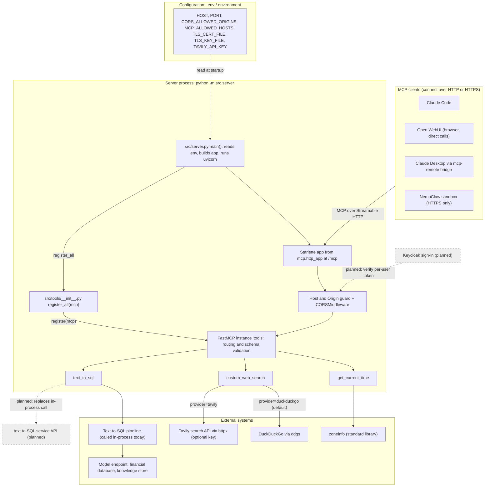
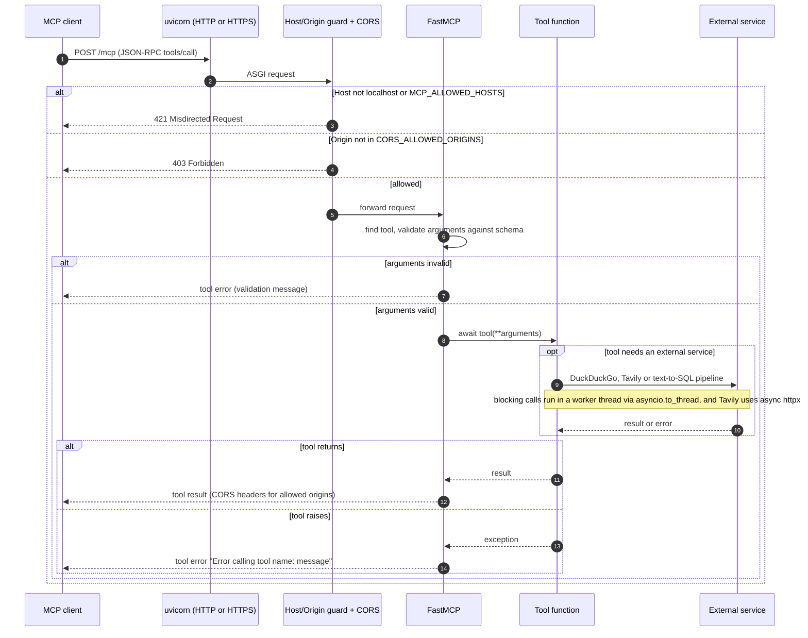
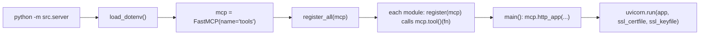

# Server design

This repository owns one thing: an MCP server that exposes tools to clients over Streamable HTTP. It is a protocol adapter. Each tool's actual work is either trivial and local (`get_current_time`), a call to a public search service (`custom_web_search`), or delegated to a separate text-to-SQL pipeline that this repository does not own (`text_to_sql`). Model choice, conversation state and tool-selection logic belong to the connecting client, not to this server.

See [Tools](../tools.md) for the per-tool contract.

## Architecture diagrams

### System overview

Solid lines are implemented. Dashed lines and shaded nodes are planned and not built; see [Planned: per-user authentication](#planned-per-user-authentication) and [Planned `text_to_sql` integration change](#planned-text_to_sql-integration-change).

### Request sequence

One `tools/call` request, in order. The Host and Origin guard and `CORSMiddleware` are shown as one step because their relative order was not verified; the observed results are in [Verification](#verification).

### Startup and registration

## Components

| File | Owns |
| --- | --- |
| `src/server.py` | The single entry point: the shared `FastMCP(name="tools")` instance, the HTTP app, CORS, the Host/Origin guard, optional TLS, and `main()`, which runs uvicorn |
| `src/tools/__init__.py` | `register_all(mcp)`, the one explicit list of tool modules |
| `src/tools/get_current_time.py` | The `get_current_time` function and its `register(mcp)` |
| `src/tools/web_search.py` | The `custom_web_search` function, its two provider helpers and its `register(mcp)` |
| `src/tools/text_to_sql.py` | The `text_to_sql` function, its `register(mcp)`, and the only integration point with the text-to-SQL pipeline |

Import direction is one-way: `src/server.py` imports `register_all` from `src/tools`, which imports the tool modules; `register_all(mcp)` calls each module's `register(mcp)`. Tool modules import nothing from `src/server.py`; they receive the instance as an argument, so there is no circular import and no registration by import side effect. Tool functions stay plain module-level functions (registered with `mcp.tool()(fn)` inside `register`), so tests can import and call them directly without a server.

This replaced two earlier layouts. Until 2026-11-20 each tool file imported `mcp` from a root `server.py` and decorated itself with `@mcp.tool()`, and `main.py` imported every tool module only to trigger that registration. Later the same day the root `server.py` and `main.py` were merged into `src/server.py`, because the circular-import reason for keeping them apart no longer applied. The server runs with `python -m src.server`, or the `mcp-tools` console script declared in `pyproject.toml`.

Adding a tool means creating a file under `src/tools/` with a typed function and a `register(mcp)` that calls `mcp.tool()(fn)`, then adding the module to the import and `_MODULES` in `src/tools/__init__.py`. A module that is not listed there is not registered.

## Request path

1. A client sends MCP over HTTP to `/mcp`.
2. uvicorn serves the Starlette app returned by `mcp.http_app(path="/mcp", ...)`.
3. The Host and Origin guard (`host_origin_protection=True`) checks the `Host` header against localhost plus `MCP_ALLOWED_HOSTS`, and any `Origin` header against `CORS_ALLOWED_ORIGINS`. Failures return `421` (Host) or `403` (Origin).
4. `CORSMiddleware` adds response headers for origins in `CORS_ALLOWED_ORIGINS`.
5. The framework routes the call to the registered tool function and validates arguments against the generated schema.
6. The tool runs. Blocking work (DuckDuckGo search, the text-to-SQL call) is moved to a worker thread with `asyncio.to_thread`; the Tavily call is natively async through `httpx`.
7. The return value, or an exception turned into a tool error, goes back to the client.

## Framework

Status: **Implemented 2026-11-20.** The server runs on the `fastmcp` library (`FastMCP`, pinned `>=4.0.5,<5.0.0`, the same range `artha-mcp` uses; 4.2.3 was installed when this was written). Until that date it used the official `mcp` SDK's `MCPServer`. The change was made because the server is intended to serve individual users with per-user Keycloak authentication, per-tool permission tiers and 100+ tools, which `fastmcp` supports directly and `artha-mcp` already uses in production. `mcp` remains installed only as a transitive dependency of `fastmcp`; this repository no longer imports it.

The three tools were ported without changing their names, parameters or schemas. Authentication is not implemented yet; see [Planned: per-user authentication](#planned-per-user-authentication).

## HTTP app and request guard

`main()` in `src/server.py` builds the app with `mcp.http_app(path="/mcp", middleware=[...], host_origin_protection=True, allowed_hosts=..., allowed_origins=...)` and runs it with `uvicorn.run(...)`. Two requirements need more than the default launcher:

- **CORS.** A browser-based client such as Open WebUI calls the server directly from the page, so the browser enforces CORS and the server must send `Access-Control-Allow-Origin` for allowed origins. `CORSMiddleware` is passed as `middleware`.
- **TLS.** `uvicorn.run` takes `ssl_certfile` and `ssl_keyfile`, set from `TLS_CERT_FILE` and `TLS_KEY_FILE`.

`host_origin_protection=True` is set explicitly. With the library default (`None`) a request with `Host: evil.test` was accepted with `200` when this was tested on 2026-11-20; with `True` it returns `421`. Localhost hosts are accepted without configuration; any other address a client uses to reach the server, such as a VM IP or a public domain, must be listed in `MCP_ALLOWED_HOSTS`.

This replaces the earlier approach (commit `1214240`, 2026-09-11) of disabling DNS-rebinding protection entirely so that requests from a VM's address were accepted.

## Runtime configuration

| Variable | Default | Effect |
| --- | --- | --- |
| `HOST` | `0.0.0.0` | Bind interface |
| `PORT` | `8100` | Listen port |
| `CORS_ALLOWED_ORIGINS` | `http://localhost:8080` | Comma-separated browser origins: sent as CORS headers and accepted by the Origin guard |
| `MCP_ALLOWED_HOSTS` | unset | Comma-separated extra `Host` header values the guard accepts; unset means localhost only |
| `TLS_CERT_FILE`, `TLS_KEY_FILE` | unset | When both are set the server serves HTTPS; when unset it serves plain HTTP |
| `TAVILY_API_KEY` | unset | Required only for `custom_web_search(provider="tavily")` |

`.env` is loaded with `python-dotenv` and is git-ignored. Only `.env.example`, which holds placeholders, is tracked. Secrets are named here by variable only. The `text_to_sql` tool has additional variables; they are not listed because that integration is changing (below).

## Planned `text_to_sql` integration change

Status: **Planned, not implemented.** No API endpoint, contract, authentication scheme or date has been decided or recorded in this repository.

Today `src/tools/text_to_sql.py` calls the text-to-SQL pipeline in-process, which makes the pipeline's whole dependency stack and its infrastructure configuration part of this server's installation. The intended direction is to run the pipeline as a separate service behind an API and have this tool call that API instead.

What would stay the same:

- The tool's name, its `question: str` parameter and its description, so existing client configurations keep working.
- The `asyncio`-friendly shape of the tool. An HTTP client call would be natively async, so the worker-thread wrapper would no longer be needed for this tool.
- The tool-error convention: failures reported by the service surface to the model as `ValueError` messages.

What would change:

- The in-process pipeline dependency and its heavy transitive packages would leave this repository's requirements.
- The model, database and knowledge-store settings would move to the service. This server would instead need the service's address and whatever credential the service requires.
- The tool would gain network failure modes (timeouts, unavailable service, non-2xx responses) that need explicit handling and a decision on retries.
- The service's request and response shapes, including how it reports the three failure classes the tool maps today, are undefined. They need to be fixed before the tool is rewritten.

All of the change is contained in `src/tools/text_to_sql.py`, which is the only file that touches the pipeline. `src/server.py` and the other tools are unaffected.

Documenting this plan does not authorize the migration. No owner or review date is assigned.

## Known gaps

- **No authentication.** Any client that can reach the port can list and call every tool. CORS limits which browser origins may call the server; it does not authenticate non-browser callers such as `curl` or a CLI client.
- **Host and Origin allowlists must be kept accurate.** The guard is on, but `MCP_ALLOWED_HOSTS` and `CORS_ALLOWED_ORIGINS` have to list every address and browser origin clients really use.
- **`CORS_ALLOWED_ORIGINS` must stay an explicit list.** `*` was used briefly during testing and was replaced by the allowlist; it should not return once the server is reachable beyond the local machine.
- **TLS is optional and manually provisioned.** The repository serves HTTPS only when a certificate and key are supplied. The self-signed pair used for sandbox testing is git-ignored (`*.pem`) and tied to one environment's address.
- **No automated tests.** There is no `tests/` directory.
- **No licence** has been chosen.

## Verification

Observed manually, not by an automated suite:

- The server starts with `python main.py` (before 2026-11-20; now `python -m src.server`) and answers on `/mcp`.
- Claude Code and Open WebUI connected and called the tools.
- A browser-origin preflight from an allowed origin received `access-control-allow-origin`; a disallowed origin did not and received a 400.

Verified on 2026-11-20 after moving to `fastmcp` and merging the entry point into `src/server.py` (started with `python -m src.server`), using a server on a spare port with `MCP_ALLOWED_HOSTS=vm.example.test` and a self-signed certificate:

- Every module in `src/tools/` is listed in `_MODULES` (checked by comparing the directory with the list).
- An in-memory `fastmcp` client listed the three tools, called `get_current_time`, and received a tool error for an unknown timezone and for an invalid `provider`.
- Over HTTPS, an `initialize` request returned `200` for the localhost `Host`, `200` for the allowlisted `Host`, and `421` for `Host: evil.test`.
- A request with `Origin: http://localhost:8080` returned `200` with `access-control-allow-origin: http://localhost:8080`; `Origin: http://example.com` returned `403`.

Not re-verified after the move: Claude Code, Open WebUI, Claude Desktop (`mcp-remote`) and the NemoClaw sandbox, which were tested on the earlier SDK-based server, and the `text_to_sql` and `custom_web_search` tools against their live backends.

Not verified: behavior under concurrent load, resource limits, long-running connections, or any deployment outside local and VM testing.

## Planned: per-user authentication

Status: **Planned, not implemented.** The server is intended for individual users who sign in through Keycloak, the identity provider also used by `artha-mcp`. No realm, client, scope names or date are recorded in this repository yet. The intended shape, following `artha-mcp`, is OAuth sign-in for MCP clients, a read-only default with a higher scope for tools that change data, permissions enforced by the backend with this server forwarding the caller's identity, and a `/health` route left open. Until this is built, any client that can reach the port can call every tool; see Known gaps.

Documenting this plan does not authorize a deployment or an identity-provider change. No owner or review date is assigned.
